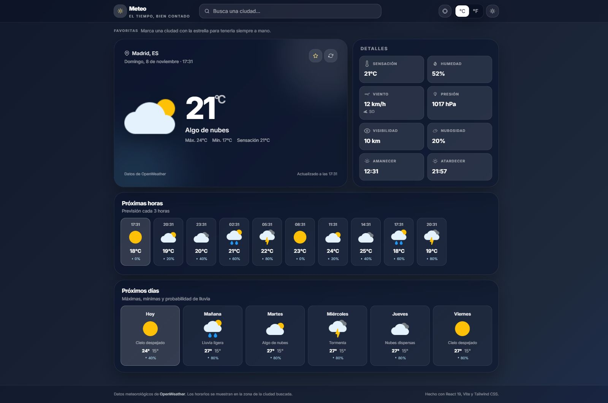
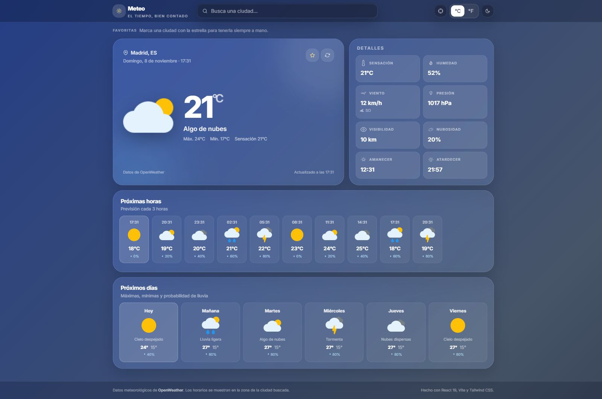
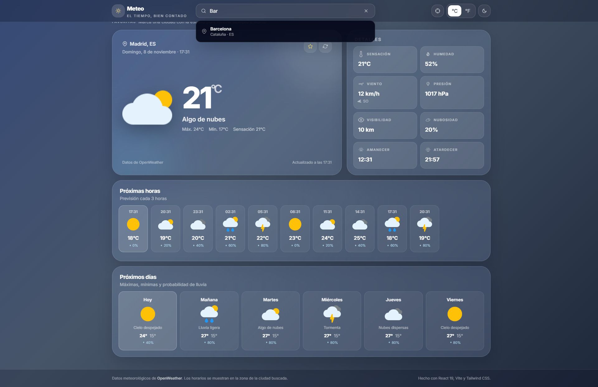

# Meteo

<p align="center">
  <strong>El tiempo, bien contado.</strong><br />
  Aplicación meteorológica moderna con previsión actual, horaria y diaria.
</p>

<p align="center">
  
  
  
  
  
  
</p>

---

## Capturas

| Modo oscuro | Modo claro |
| --- | --- |
|  |  |



## Características

### Tiempo

- Tiempo actual con temperatura, sensación térmica, máximas/mínimas, humedad, viento, presión, visibilidad, nubosidad, amanecer y atardecer.
- Previsión **cada 3 horas** para las próximas horas.
- Previsión **diaria agregada** con máximas, mínimas, condición y probabilidad de lluvia.
- Fondos dinámicos según la condición meteorológica y el día/noche.
- Actualización manual y hora de última actualización.
- Formatos localizados en español para fechas, horas y direcciones del viento.

### Búsqueda y ubicación

- Buscador con **sugerencias en tiempo real** (debounce de 350 ms) y navegación por teclado.
- Búsqueda por nombre de ciudad con geocodificación.
- Botón de **geolocalización** del navegador.
- Ciudad por defecto configurable.
- Ciudades **favoritas** persistentes, con acceso rápido y eliminación.

### Experiencia

- Diseño responsive con Tailwind CSS 4.
- Modo claro/oscuro persistente y respeto de la preferencia del sistema.
- Cambio de unidades **°C / °F** con recarga automática de los datos.
- Estados de carga (skeletons), error con reintento y avisos de geolocalización.
- Animaciones suaves y soporte de `prefers-reduced-motion`.
- Accesibilidad: roles ARIA, labels, foco visible y navegación con teclado.
- Persistencia de ajustes, favoritos y última ubicación con Redux Persist.

## Stack

| Capa | Tecnología |
| --- | --- |
| UI | React 19 |
| Build | Vite 8 |
| Estilos | Tailwind CSS 4 + `@tailwindcss/vite` |
| Estado | Redux Toolkit 2 + React Redux 9 + Redux Persist |
| HTTP | Axios |
| Iconos | React Icons |
| API | OpenWeather (Current + 5 day / 3 hour Forecast + Geocoding) |
| Tests | Vitest 5 + Testing Library + jsdom |
| Calidad | ESLint 9 con flat config |

## Requisitos

- Node.js 20.19 o superior (recomendado Node 22 LTS).
- Una API key gratuita de [OpenWeather](https://home.openweathermap.org/api_keys).

## Instalación

```bash
git clone https://github.com/Yorch82/WeatherApp.git
cd WeatherApp
npm install
cp .env.example .env
# Windows: copy .env.example .env
```

Edita `.env`:

```env
VITE_OPENWEATHER_API_KEY=tu_api_key
```

Después:

```bash
npm run dev
```

La app se abre en `http://localhost:5173`.

> La key gratuita de OpenWeather puede tardar unos minutos en activarse después de crearla.

## Variables de entorno

| Variable | Obligatoria | Descripción |
| --- | --- | --- |
| `VITE_OPENWEATHER_API_KEY` | Sí | API key de OpenWeather. |
| `VITE_WEATHER_API_BASE` | No | Base de datos meteorológicos. Por defecto `https://api.openweathermap.org/data/2.5`. |
| `VITE_GEO_API_BASE` | No | Base de geocodificación. Por defecto `https://api.openweathermap.org/geo/1.0`. |
| `VITE_DEFAULT_CITY` | No | Ciudad inicial. Si se omite, se usa Madrid. |

### Sobre la exposición de la API key

OpenWeather se llama directamente desde el navegador, por lo que la key forma parte del bundle público. Para un entorno de producción serio, crea un proxy serverless (Netlify Functions, Cloudflare Workers, Vercel Functions…) que guarde la key en el servidor y exponga solo tu endpoint. La app ya acepta una base de API configurable, así que puedes apuntar `VITE_WEATHER_API_BASE` y `VITE_GEO_API_BASE` a tu proxy sin cambiar el código.

## Scripts

| Comando | Descripción |
| --- | --- |
| `npm run dev` | Servidor de desarrollo con HMR. |
| `npm run build` | Build de producción en `dist/`. |
| `npm run preview` | Sirve el build localmente. |
| `npm run lint` | Ejecuta ESLint. |
| `npm test` | Ejecuta la suite una vez. |
| `npm run test:watch` | Tests en modo watch. |
| `npm run test:coverage` | Cobertura con V8. |

## Estructura

```text
.
├── index.html
├── vite.config.js
├── eslint.config.js
├── netlify.toml
├── docs/screenshots/
└── src/
    ├── app/store.js              # Redux + persistencia
    ├── components/               # UI (buscador, tarjetas, estados…)
    ├── features/
    │   ├── weather/              # estado y thunks del tiempo
    │   ├── settings/             # unidades y tema
    │   └── favorites/            # ciudades favoritas
    ├── services/weatherService.js
    ├── test/                     # setup, fixtures y helpers
    ├── utils/                    # formato, errores, storage, tiempo
    ├── App.jsx
    ├── config.js
    ├── index.css
    └── main.jsx
```

## Cómo funciona

1. Al arrancar, `App` recupera la última ubicación persistida o carga Madrid.
2. `weatherSlice` pide en paralelo el tiempo actual y la previsión a OpenWeather.
3. La previsión horaria se muestra en una tira horizontal y la diaria se agrupa por fecha local de la ciudad.
4. El buscador usa la API de geocodificación con debounce y permite elegir una ciudad con ratón o teclado.
5. Al cambiar de unidades, se vuelve a consultar la API con `metric` o `imperial`; los favoritos y ajustes se conservan.
6. Los errores de red, API key, límite de peticiones o ciudad inexistente se traducen a mensajes claros.

## Tests

```bash
npm test
npm run test:coverage
```

La suite actual incluye **57 tests en 11 archivos** y cubre:

- Utilidades de temperatura, viento, visibilidad, presión, fechas, iconos, temas y agrupación diaria.
- Traducción de errores HTTP y de geolocalización.
- Slices de ajustes, favoritos y tiempo (éxito, unidades, ciudad no encontrada, API key inválida y refresh).
- Servicio de OpenWeather con Axios mockeado (geocodificación, reverse geocoding, current, forecast y ciudad inexistente).
- Componentes: buscador con sugerencias y teclado, tiempo actual, previsión horaria/diaria, detalles, favoritos y estados de error.
- Integración de `App`: carga inicial, cambio de unidades, favoritos, geolocalización y error de API key.

## Build y despliegue

```bash
npm run build
npm run preview
```

### Netlify

El proyecto incluye `netlify.toml`:

```toml
[build]
  command = "npm run build"
  publish = "dist"

[[redirects]]
  from = "/*"
  to = "/index.html"
  status = 200
```

Configura `VITE_OPENWEATHER_API_KEY` en **Site settings → Environment variables** y vuelve a desplegar. Vite embebe las variables `VITE_*` en tiempo de build.

### Docker

```dockerfile
FROM node:22-alpine AS build
WORKDIR /app
COPY package*.json ./
RUN npm ci
COPY . .
ARG VITE_OPENWEATHER_API_KEY
ENV VITE_OPENWEATHER_API_KEY=$VITE_OPENWEATHER_API_KEY
RUN npm run build

FROM nginx:alpine
COPY --from=build /app/dist /usr/share/nginx/html
```

## Limitaciones conocidas

- El plan gratuito de OpenWeather ofrece previsión de 5 días en intervalos de 3 horas; la app agrupa esos datos por día.
- La API key se expone en el cliente al llamar directamente a OpenWeather.
- No se muestran alertas meteorológicas ni calidad del aire (requieren APIs adicionales).
- La geolocalización depende de que el navegador conceda permiso.

## Licencia

Proyecto de código abierto con fines educativos.

## Contacto

Jorge — [GitHub](https://github.com/Yorch82)
